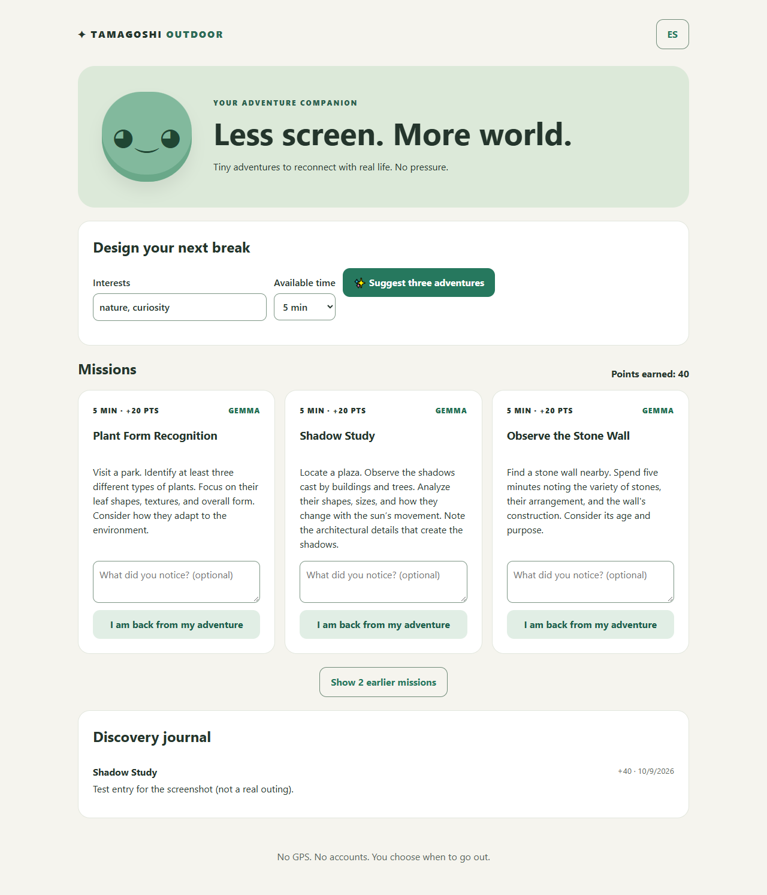
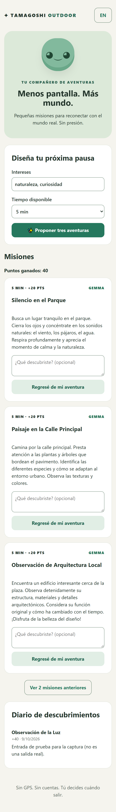
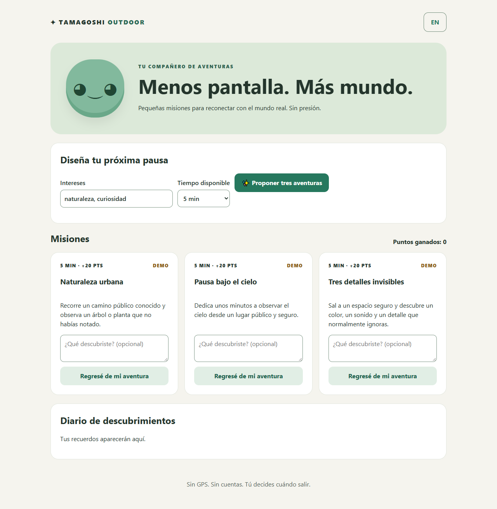

# Tamagoshi Outdoor

**Less screen. More world.** A local, open-model companion that suggests three tiny outdoor missions
(5–15 minutes) to adults who spend their days at a desk. Gemma 3 4B runs on your own machine through Ollama.
No account, no GPS, no streaks; your journal stays in a local SQLite file.

Built for the [Hacktoberfest Open-Source AI Challenge: Week 1 — Touch Grass](https://dev.to/challenges/hacktoberfest-week1-2026-10-05) on DEV.



<p>
  
  
</p>

Screenshot details and provenance: [`docs/screenshots/README.md`](docs/screenshots/README.md).

## Features
- Three missions per request from a local Gemma model, in Spanish or English
- Strict validation of the model's JSON, one retry, then clearly labeled **DEMO** missions if Gemma is offline or invalid
- Optional one-line reflection when you come back; points and a discovery journal
- Completion is idempotent: a mission can only award points once, even under concurrent requests
- Accessible, mobile-first UI (WCAG AA contrast, visible focus, labeled controls)
- No GPS, no accounts, no analytics, no claims of verified outdoor activity

## Quick start
Requirements: Python 3.10+, Node 20.19+ (or 22.12+), and [Ollama](https://ollama.com) for real AI missions.

```bash
ollama pull gemma3:4b

cd backend
python -m venv .venv
# Windows: .venv\Scripts\activate    macOS/Linux: source .venv/bin/activate
pip install -r requirements.txt
uvicorn app.main:app --reload            # http://localhost:8000

cd ../frontend                           # second terminal
npm install
npm run dev                              # http://localhost:5173
```

Configuration lives in `backend/.env` (copy `backend/.env.example`): `OLLAMA_URL`, `OLLAMA_MODEL`,
`OLLAMA_TIMEOUT` (default 120 s), `AI_ATTEMPTS` (default 2), `DB_PATH`, `CORS_ORIGINS`.
Without Ollama the app still works and returns curated demo missions, labeled as such.

Docker alternative: `docker compose up --build`, then open http://localhost:8080 (Ollama must run on the host).
The compose file is validated but the images were not built during QA; see the QA report.

## How mission generation works
- The backend asks Gemma for exactly three missions as JSON and validates them with a strict Pydantic schema:
  exactly 3 items, string `title` (3–90 chars) and `description` (12–240 chars), distinct titles, no markup,
  control characters or leaked JSON, and no unsafe terms (private property, roofs, traffic, spending money, GPS…).
- User interests are sanitized and wrapped in `<interests>` tags the model is told to treat as themes only.
- Invalid output is retried once. If Gemma is still invalid or unreachable, curated demo missions are returned with
  `source: "demo"` and `fallback_reason: "ai_unavailable"` or `"ai_invalid_output"`; the UI explains which.
- On a CPU-only laptop a generation takes roughly 40–85 s; the first call also loads the model into memory.

## Tests and QA
```bash
cd backend && python -m pytest          # 65 tests
cd frontend && npm run build
python backend/scripts/smoke_api.py     # live check against a running backend + Ollama
```
Results, security review and known limitations: [`docs/QA_REPORT.md`](docs/QA_REPORT.md).

## Security notes
Single-user local app: no auth and no rate limiting. Keep the backend on localhost
(`npm run dev` and Docker Compose bind to 127.0.0.1; `npm run dev:lan` deliberately exposes the dev server on your network).

## API
| Method | Path | Notes |
| --- | --- | --- |
| GET | `/health` | `{"ok": true}` |
| POST | `/missions/generate` | `{interests, minutes: 5–30, language: "es"\|"en"}` → 3 missions, `source`, `fallback_reason` |
| GET | `/missions` | latest 100 missions |
| POST | `/missions/{id}/complete` | `{reflection?}` → 200 once, then 409 |
| GET | `/journal` | entries and `total_points` |

## Staging deploy

The static frontend is uploaded over FTPS to shared hosting; the backend and Gemma keep running on the
developer machine and are exposed through a Cloudflare Tunnel. Only one generation runs at a time
(a second request gets HTTP 429). All visitors share one mission list and journal, so staging is for demos, not personal data.

```powershell
# backend with the staging origin allowed and its own database
$env:CORS_ORIGINS='https://outdoor-staging.privantix.io'; $env:DB_PATH="$PWD\backend\staging.db"; $env:OLLAMA_TIMEOUT='240'
# then: uvicorn on 127.0.0.1:8000, and  cloudflared tunnel --url http://127.0.0.1:8000
.\scripts\deploy_staging.ps1 -ApiUrl https://<tunnel>.trycloudflare.com
```

The script reads credentials from `C:\09_IA\sftp\config.env` (never commit it), backs up the remote
folder into `deploy-backups/`, writes `config.js` with the API URL and uploads `index.html` last.
A quick tunnel gets a new URL on every restart, so rerun the script with `-SkipBuild` after restarting it.

## Project docs
- [`RELEASES.md`](RELEASES.md): release plan R01–R06 and status
- [`docs/DEMO_STORYBOARD.md`](docs/DEMO_STORYBOARD.md): 90-second demo plan
- [`docs/DEV_ARTICLE_DRAFT.md`](docs/DEV_ARTICLE_DRAFT.md): DEV submission draft (English)
- [`SUBMISSION_CHECKLIST.md`](SUBMISSION_CHECKLIST.md): verified rules, deadline and remaining steps

## Development timeline
Developed during the challenge entry period (Oct 5–11, 2026). Commits made after the submission deadline
(Oct 11, 2026 11:59 PM PDT) will be listed here.

## License
[MIT](LICENSE)
